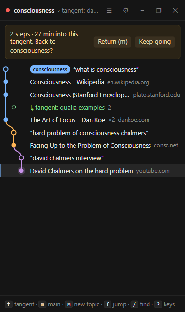
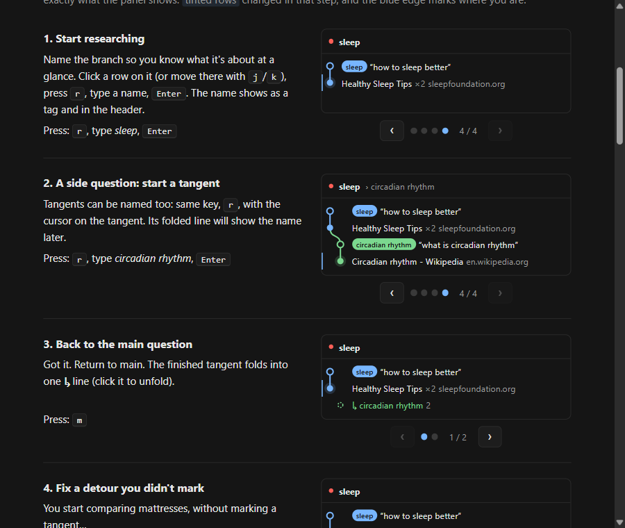
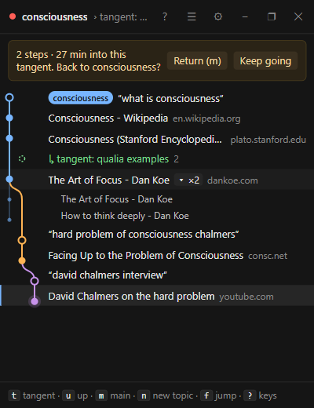
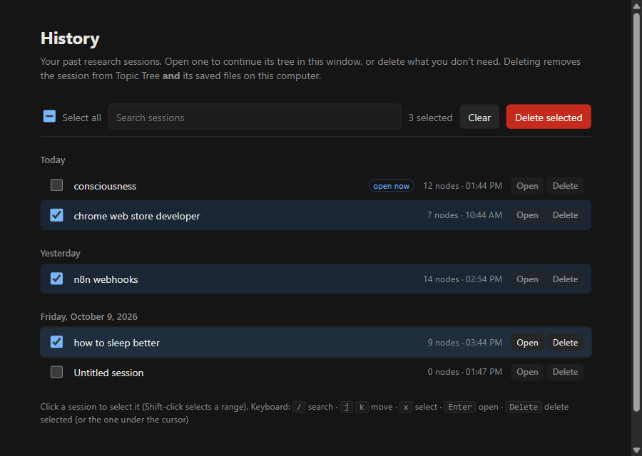

# Topic Tree

A Brave / Chrome extension that keeps your **main line of thought** visible while you research.
Every search and page you visit lands on a tree, drawn like a git graph. When you go off on a side
question you mark it as a **tangent**, and the tree shows you the way back.

<p>
  
  &nbsp;
  
</p>

- **Main branch, tangents, topic shifts.** New pages go on the branch you're on. Press `t` for a
  tangent, `u` to step back one level, `m` to return to main, `n` for a new topic.
- **Fix it afterwards.** Forgot to mark a detour? Select those pages and turn them into a tangent,
  a tangent *of another branch*, back into main, or a new topic.
- **Drift alarm.** When a tangent gets too long (steps or minutes, your choice), a banner offers
  the way back.
- **Compact.** Finished tangents fold into one line; pages on one site group into one node (and
  unfold with a click).
- **Keyboard-first, mouse-friendly.** Vim-style keys, every button clickable, a built-in guide
  with step-through examples.
- **History.** Resume or delete past sessions.
- **Private.** Everything stays on your computer. Nothing is sent anywhere.

## Install (no build needed)

> **Requirements:** Brave or Chrome on Windows. **Python is not needed** to use Topic Tree; it's only
> needed for the optional *save sessions to disk* feature below.

1. Download the latest **`Topic-Tree-vX.Y.Z.zip`** from
   [Releases](https://github.com/PhantomCoderHaha/Topic-Tree/releases) and unzip it somewhere
   permanent (e.g. `Documents\Topic-Tree`). The browser loads the extension from that folder, so
   don't delete it.
2. Open `brave://extensions` (or `chrome://extensions`) and switch on **Developer mode** (top right).
3. Click **Load unpacked** and choose the **`extension`** folder from the zip.
4. Pin **Topic Tree** (puzzle-piece icon in the toolbar), click it, and press **?** for the guide.

The guide opens on first install and walks through a full example, frame by frame.

### Optional: save every session to disk

> ⚠️ **This part needs Python 3 installed on your laptop.**
> Get it from [python.org/downloads](https://www.python.org/downloads/) and tick
> **"Add python.exe to PATH"** during setup.

Then right-click `native-host\install-host.ps1` in the unzipped folder → **Run with PowerShell**, and
reload the extension. In the panel, ⚙ Settings should say **"Saving to disk: connected"**.

Sessions are then mirrored to `%LOCALAPPDATA%\TopicTree\sessions\` as `<session>.jsonl` (every
event) and `<session>.tree.json` (the tree), with a `README.md` describing the format. That's
useful if you want to analyse your own research habits later. Without Python, everything else works.

### Updating

Download the new zip, replace the old folder's contents, then click **↻ reload** on the extension
card in `brave://extensions`. Your sessions are kept.

## Using it

| Key | Action |
|---|---|
| `t` | start a tangent |
| `u` | close the tangent, up one level |
| `m` | back to the main branch |
| `n` | new topic |
| `b` | previous branch |
| `f` / `/` | jump to a branch by label / find by name |
| `r` / `e` | name the branch / the node |
| `v` then `t` `p` `m` `n` | mark past pages as a tangent / tangent of… / back to main / new topic |
| `l` / `h` | unfold / fold (tangents, and ×N site nodes) |
| `?` | all keys |

**Go back to anything:** double-click a node (or select it and press `Enter`) to reopen that search or
website. Reopening isn't recorded, so it doesn't clutter the tree.

From any web page: **`Ctrl+Shift+Y`** then `t` `u` `m` `n` or `b`, without leaving the page
(change the shortcut at `brave://extensions/shortcuts`).

Panel buttons: **?** guide · **☰** sessions & history · **⚙** settings · **−** hide (keeps recording)
· **❐/□** float as a card / dock · **✕** stop recording (asks first).

<p>
  
  &nbsp;
  
</p>

## Privacy

Topic Tree needs to see the pages you visit in order to draw the tree, so the browser will show
broad permissions when you load it. All data stays in the browser's local storage and, if you
enable it, in files on your own computer. There are no servers, no analytics and no network
requests. Click **✕** to stop recording a session, or delete sessions in **☰ → Manage history…**.

## Building from source

Needs Node.js 20+.

```bash
npm install
npm test          # 43 tests: tree logic, layout, compact view, capture rules
npm run build     # -> dist/  (load unpacked)
npm run release   # -> release/Topic-Tree-v<version>.zip
```

`dist/preview.html` (served over http) shows the panel with a sample session, for design work
without the browser extension.

| Path | What |
|---|---|
| `src/core/` | Event schema, the event log → tree reducer, git-graph layout (pure, tested) |
| `src/panel/` | The panel UI: docked side panel and floating card |
| `src/background.ts` | Recorder: searches, pages, drift alarm, sessions, history |
| `src/content.ts` | Floating card and the `Ctrl+Shift+Y` key in web pages |
| `src/guide.ts`, `src/history.ts` | Guide example, history manager |
| `native-host/` | Optional Python disk mirror + its installer |
| `spike-sidepanel/` | Throwaway check from development; not part of the extension |

## Licence

[PolyForm Noncommercial 1.0.0](LICENSE): free for personal and other non-commercial use.
Commercial use is not permitted.
